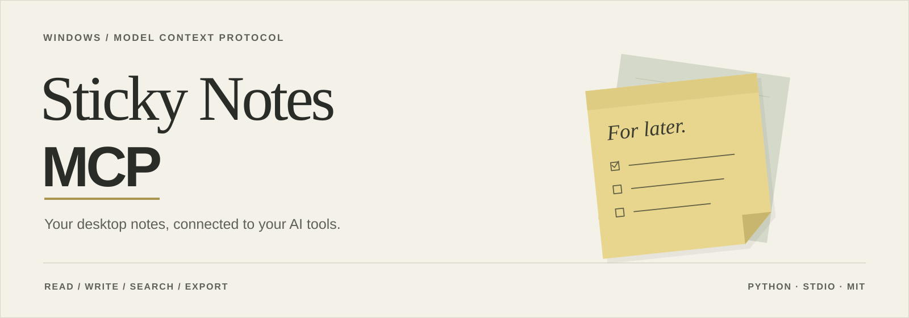

<p align="center">
  
</p>

# Sticky Notes MCP

Connect an MCP-compatible AI client to Microsoft Sticky Notes on Windows. Read, search, create, and organize notes through a local server that works directly with the app's `plum.sqlite` database.

**Windows 10 / 11** · **Python 3.10+** · **stdio transport** · **[MIT license](LICENSE)**

[Getting started](#getting-started) · [Client setup](#client-setup) · [Tools](#tools) · [Data handling](#data-handling-and-limitations)

## What you can do

- Find notes by keyword, color, or saved open/closed state.
- Read complete notes with cleaned Markdown and original text.
- Create notes, replace their content, or append new lines.
- Change note colors and saved visibility or always-on-top flags.
- Soft-delete and restore notes, or permanently delete them when explicitly requested.
- Export active notes to Markdown or JSON and inspect note counts by color.

The server exposes nine tools and uses the MCP SDK plus Python's standard library. It runs locally over stdio; it does not start an HTTP service.

## Getting started

### Requirements

- Windows 10 or Windows 11.
- Python 3.10 or later and Git.
- Microsoft Sticky Notes with an existing local `plum.sqlite` database. Open the app and create a note before using the server for the first time.
- An MCP client that supports launching a local stdio server.

This project targets the Windows UWP Sticky Notes database layout. Other editions or storage formats may not be compatible.

### Install from source

Run in PowerShell:

```powershell
git clone https://github.com/widisaadi/stickynotes-mcp.git
cd stickynotes-mcp
python -m venv .venv
.\.venv\Scripts\python.exe -m pip install -e .
```

Keep the repository in a stable location, then configure your client with the absolute paths below.

## Client setup

For clients that use an `mcpServers` JSON configuration, merge this entry into the existing configuration:

```json
{
  "mcpServers": {
    "sticky-notes": {
      "command": "C:\\path\\to\\stickynotes-mcp\\.venv\\Scripts\\python.exe",
      "args": ["C:\\path\\to\\stickynotes-mcp\\server.py"]
    }
  }
}
```

Replace both example paths with your actual installation folder. Using the virtual environment's Python executable ensures the client can find the installed dependencies.

If your client provides a setup form or uses a different configuration format, use these values:

| Setting | Value |
| --- | --- |
| Name | `sticky-notes` |
| Transport | `stdio` |
| Command | Absolute path to `.venv\Scripts\python.exe` |
| Arguments | Absolute path to `server.py` as a single argument |
| Environment | Optional `STICKY_NOTES_DB_PATH`; see [Database location](#database-location) |

Restart or reconnect the client after saving. Confirm that it lists the nine tools below, then try a read-only request such as “List my five most recently updated sticky notes.”

### Example requests

- “Find my notes that mention the release checklist.”
- “Create a yellow note with these three tasks.”
- “Append ‘Review the screenshots’ to this note.”
- “Export my active notes as Markdown.”

Use a note's ID from `list_notes` or `search_notes` when selecting a specific note to change.

## Tools

| Tool | Purpose | Parameters |
| --- | --- | --- |
| `list_notes` | List previews and metadata, newest updates first | `limit=50`, `offset=0`, `theme`, `is_open`, `include_deleted=false` |
| `get_note` | Read cleaned text, raw text, and note metadata | `note_id` |
| `search_notes` | Search stored text using SQLite `LIKE` | `query`, `limit=50`, `include_deleted=false` |
| `create_note` | Create a note with content and state flags | `text`, `theme="Yellow"`, `is_open=true`, `is_always_on_top=false` |
| `update_note` | Replace or append text; change color or state flags | `note_id`, `text`, `append_text`, `theme`, `is_open`, `is_always_on_top` |
| `delete_note` | Soft-delete by default; optionally delete permanently | `note_id`, `permanent=false` |
| `restore_note` | Restore a soft-deleted note | `note_id` |
| `get_stats` | Count active, open, and deleted notes; group active notes by theme | None |
| `export_notes` | Write active notes to a Markdown or JSON file | `export_format="markdown"`, `output_dir` |

**Colors:** `Yellow`, `Green`, `Pink`, `Purple`, `Blue`, `Grey`, `Charcoal`.

When both `text` and `append_text` are supplied to `update_note`, `text` takes precedence. Search supports SQL wildcard characters: `%` matches any sequence and `_` matches one character.

Exports default to the `Documents` folder under the current user's home directory. Set `output_dir` to choose another location. Exported content includes cleaned text and metadata, rather than a complete database backup.

## Database location

By default, the server looks for:

```text
%LOCALAPPDATA%\Packages\Microsoft.MicrosoftStickyNotes_8wekyb3d8bbwe\LocalState\plum.sqlite
```

To use a different database, add `env` to the server entry in your client's configuration:

```json
"env": {
  "STICKY_NOTES_DB_PATH": "C:\\path\\to\\plum.sqlite"
}
```

For a manual session in PowerShell:

```powershell
$env:STICKY_NOTES_DB_PATH = "C:\path\to\plum.sqlite"
.\.venv\Scripts\python.exe server.py
```

The process waits for MCP messages over standard input. It is a server process, so running it manually does not open an interactive notes interface.

## Data handling and limitations

This is an independent project and is not affiliated with Microsoft. It edits the local database directly rather than calling a Microsoft service API.

- **Read and write access:** Retrieval tools open SQLite in read-only mode. Mutations use a separate read-write connection with a 10-second lock timeout; database contention is still possible.
- **Backup behavior:** Before a mutation, the server attempts to copy the database to `plum.sqlite.mcp.bak` in the same directory. Each attempt overwrites that file, and a failed copy does not stop the write. The copy does not include SQLite WAL/SHM sidecar files, so it should not be treated as a consistent backup of an active database. Close Sticky Notes and keep an independent backup before using write tools on important notes.
- **Deletion:** Soft deletion sets a timestamp and can be reversed with `restore_note`. Permanent deletion removes the database row and cannot be reversed with that tool.
- **Desktop state:** Visibility and always-on-top options update stored database flags. The server does not directly control app windows or guarantee an immediate desktop refresh or cloud sync.
- **Formatting:** Common Sticky Notes formatting is converted to Markdown using a lightweight cleaner. It does not preserve every rich-text feature.
- **Client access:** Note contents are returned to the connected MCP client. Its model provider and privacy settings determine how that content is handled after retrieval.

## Troubleshooting

| Problem | What to check |
| --- | --- |
| Database not found | Open Sticky Notes and create a note. Check the default location or set `STICKY_NOTES_DB_PATH` to an existing database. |
| Client cannot start the server | Confirm both absolute paths and install dependencies with the same virtual environment's Python executable. |
| Database is locked | Close Sticky Notes and retry the operation after the current database write finishes. |
| Changes are not visible in the app | Reopen Sticky Notes. Updates to stored flags may not immediately affect existing windows. |
| SQL errors about missing tables or columns | The database may use a different schema. This server expects the UWP `Note` and `User` tables used in `server.py`. |

## Landing page

The responsive landing page lives in [`docs/`](docs/). It uses plain HTML, CSS, and JavaScript, with no build step or external runtime dependencies. Its interactive examples use fictional sample data and do not access your notes.

Newsreader and Plus Jakarta Sans are served from local font files. Their SIL Open Font License notices are included in [`docs/fonts/`](docs/fonts/).

Preview it locally from the repository root:

```powershell
python -m http.server 4173 --directory docs --bind 127.0.0.1
```

Open [the local preview](http://127.0.0.1:4173) in your browser. Stop the preview with `Ctrl+C` when finished.

Two scroll treatments are included: the editorial page at `/` and the cinematic paper-trail version at `/cinematic/`. The page switcher opens either version. Both keep a complete mobile and reduced-motion layout. The locally bundled ScrollCraft engine is attributed in [`docs/vendor/SCROLLCRAFT-SOURCE.md`](docs/vendor/SCROLLCRAFT-SOURCE.md).

## Development

`server.py` contains the server and all nine tools. `test_server.py` runs 11 self-check stages, including text cleanup, note operations, deletion, restoration, and export.

The test script expects a non-empty Sticky Notes database at the default location and copies it to `%LOCALAPPDATA%\hermes\cache\scratch`. It uses that copy for mutations and writes exports there. It hardcodes these paths and overrides `STICKY_NOTES_DB_PATH`; setting that variable externally does not redirect the tests. The scratch copy and exports contain note data.

To run the existing checks on Windows, close Sticky Notes first, then use PowerShell:

```powershell
New-Item -ItemType Directory -Force "$env:LOCALAPPDATA\hermes\cache\scratch" | Out-Null
.\.venv\Scripts\python.exe test_server.py
```

For bug reports, include your Python version, Sticky Notes version, client name, and the error message. Remove private note contents and personal paths before sharing logs.

## License

Released under the [MIT license](LICENSE).
